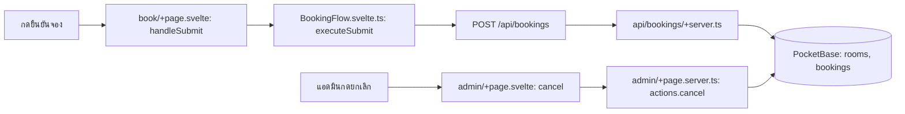

# Booking — กดแล้วโค้ดไปไหน

| ผู้ใช้ทำอะไร | ตามไฟล์และฟังก์ชัน | ผลลัพธ์ |
| --- | --- | --- |
| เลือกห้อง/วันเวลา | [book/+page.svelte](src/routes/book/+page.svelte) → [BookingFlow.svelte.ts](src/lib/components/booking/BookingFlow.svelte.ts) `loadRooms`, `loadBookingsForSelected` | โหลดห้องและ booking ของช่วงที่เลือกเพื่อแสดงคิว |
| กดยืนยันส่งคำขอ | ฟอร์ม `onsubmit` → `handleSubmit()` → `executeSubmit()` ใน [BookingFlow.svelte.ts](src/lib/components/booking/BookingFlow.svelte.ts) → `POST /api/bookings` ใน [api/bookings/+server.ts](src/routes/api/bookings/+server.ts) | API ตรวจสิทธิ์ ห้อง และช่วงเวลา ก่อนสร้าง record `bookings`; หน้าแสดงว่าส่งคำขอแล้วและรอผู้ดูแลอนุมัติ |
| แอดมินกดยกเลิก | [admin/+page.svelte](src/routes/admin/+page.svelte) `cancel()` → `POST ?/cancel` → `actions.cancel` ใน [admin/+page.server.ts](src/routes/admin/+page.server.ts) | ปรับสถานะ booking และโหลดรายการใหม่ |
| ผู้ใช้แก้ไข/ยกเลิก booking ผ่าน API | `PATCH`/`DELETE` ใน [api/bookings/[bookingId]/+server.ts](src/routes/api/bookings/%5BbookingId%5D/+server.ts) | ตรวจเจ้าของ/สิทธิ์ก่อนเปลี่ยน record |

อ่าน [คู่มือระบบ](../Docs/HandOn/booking.md) สำหรับกติกาเวลาและการอนุมัติ
